<p align="center">
  
</p>

<h1 align="center">Kolektaku</h1>


Aplikasi Android pribadi untuk menonton anime serta membaca komik dan novel, dengan katalog dari AniList dan MyAnimeList. Subtitle, sinopsis, dan teks novel berbahasa asing diterjemahkan otomatis ke bahasa pilihan (Indonesia dari awal), dan warna aksen aplikasi bisa dipilih. Antarmuka ditulis dengan Flutter, logika dan pengambilan data dengan Rust.

Kolektaku mengabari saat favoritmu punya episode atau chapter baru, membaca komik dan novel dengan gulir tersambung antar chapter, dan membiarkanmu menyorot kalimat di novel untuk disimpan di Koleksi.

Tanpa server sendiri: semua pekerjaan berjalan di ponsel, dan pembaruan diambil dari rilis GitHub repo ini.

## Memasang

Kolektaku dibagikan lewat halaman [Releases](https://github.com/Noptzy/kolektaku-mobile/releases) repo ini.

1. Buka rilis terbaru lalu unduh satu berkas `kolektaku-mobile-<versi>.apk`. Berkas itu berjalan di ponsel Android 64-bit maupun 32-bit, jadi tidak ada pilihan lain yang perlu dipikirkan.
2. Buka berkas yang terunduh. Saat diminta, izinkan pemasangan dari sumber ini ("instal aplikasi tidak dikenal").
3. Pasang, lalu buka Kolektaku.

Pembaruan berikutnya tidak perlu mengunduh manual: aplikasi memeriksa rilis baru sendiri setiap dibuka dan mengunduhnya otomatis, lalu tinggal ketuk Pasang. Kamu juga bisa memeriksanya kapan saja lewat Pengaturan → Pembaruan. APK diverifikasi dengan SHA-256 sebelum dipasang.

## Tampilan

<table align="center">
  <tr>
    <td align="center">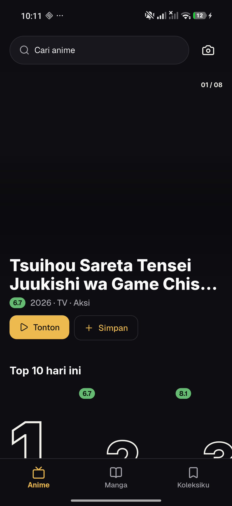<br><sub>Beranda</sub></td>
    <td align="center">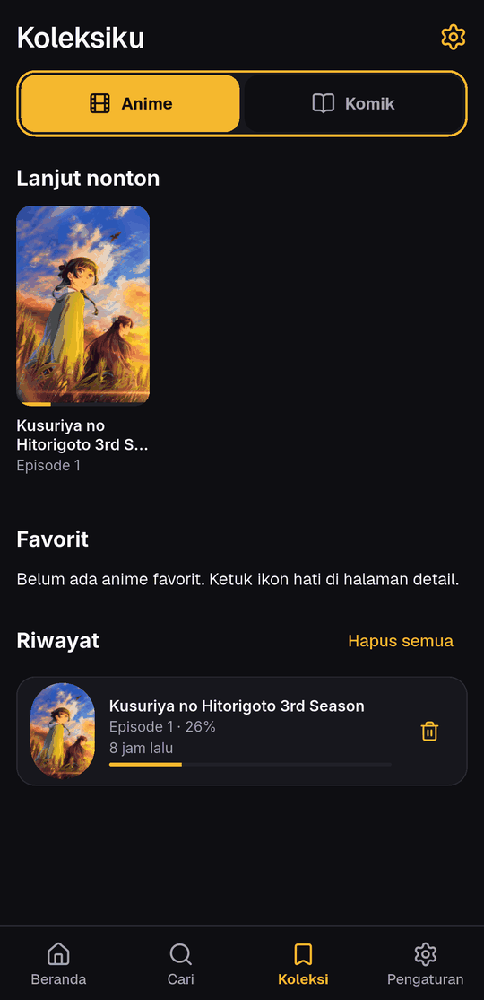<br><sub>Koleksi</sub></td>
    <td align="center">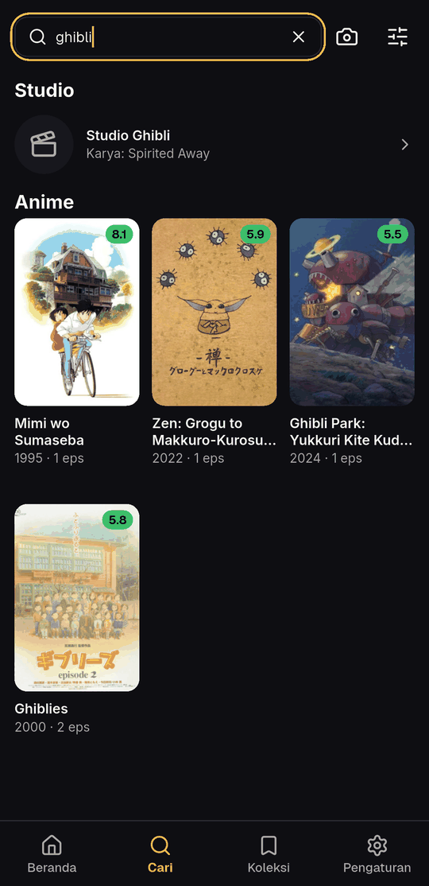<br><sub>Cari, studio dikenali otomatis</sub></td>
  </tr>
  <tr>
    <td align="center">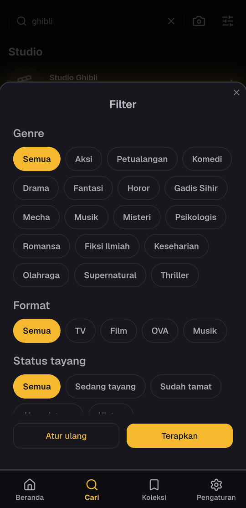<br><sub>Filter</sub></td>
    <td align="center">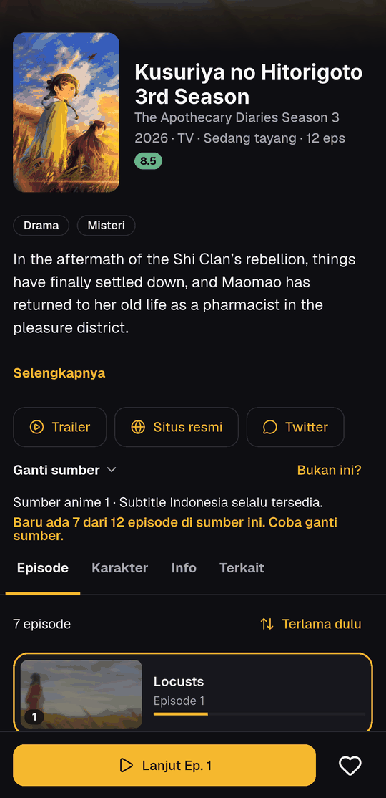<br><sub>Detail dan ganti sumber</sub></td>
    <td align="center">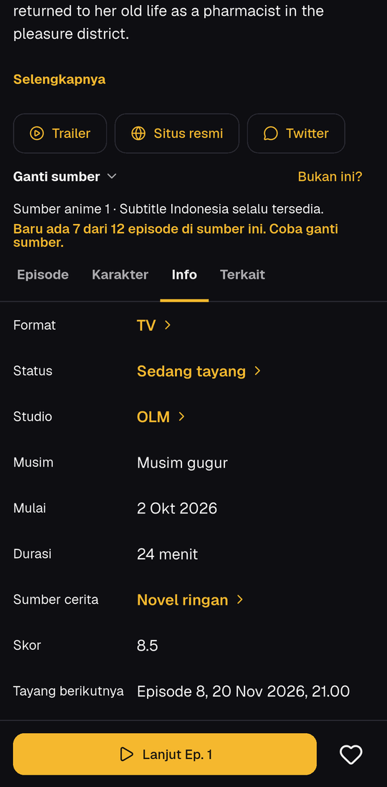<br><sub>Info yang bisa diklik</sub></td>
  </tr>
  <tr>
    <td align="center">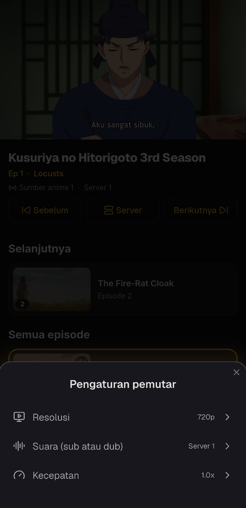<br><sub>Pengaturan pemutar</sub></td>
    <td align="center">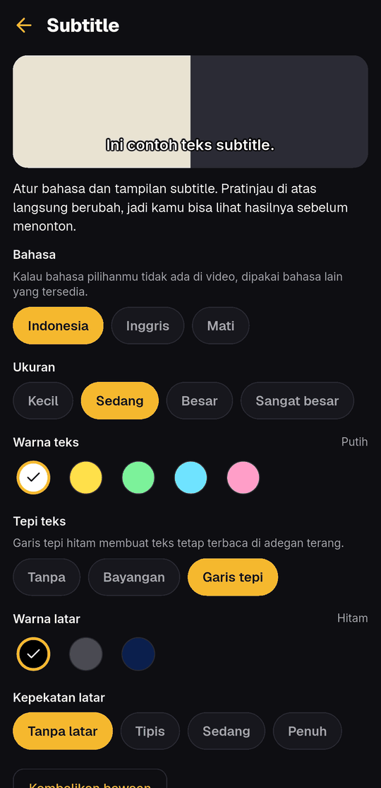<br><sub>Subtitle dengan pratinjau</sub></td>
    <td align="center">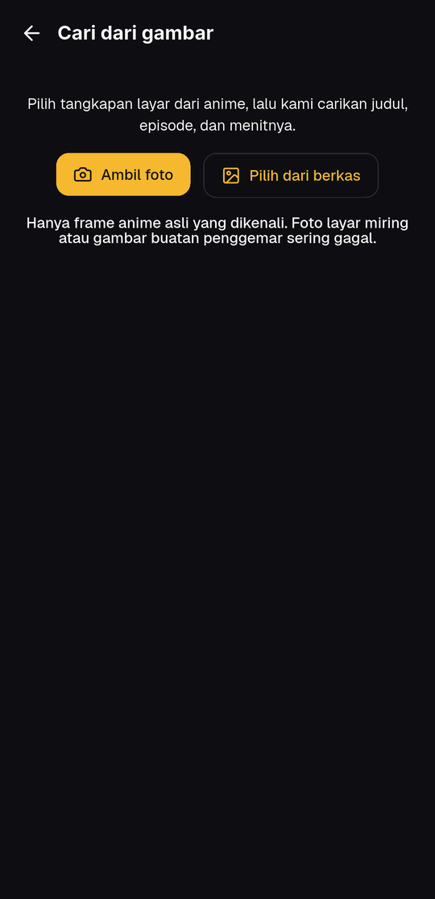<br><sub>Cari dari gambar</sub></td>
  </tr>
  <tr>
    <td align="center">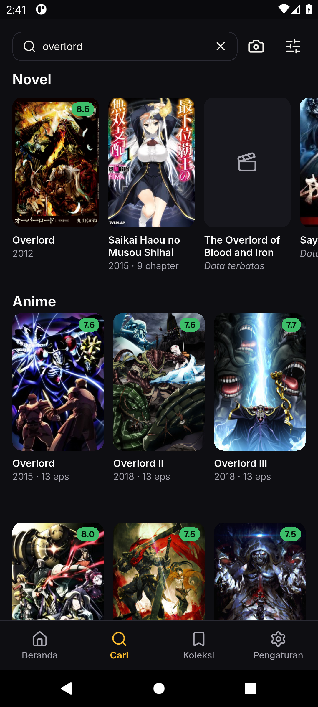<br><sub>Cari, novel punya rel sendiri</sub></td>
    <td align="center">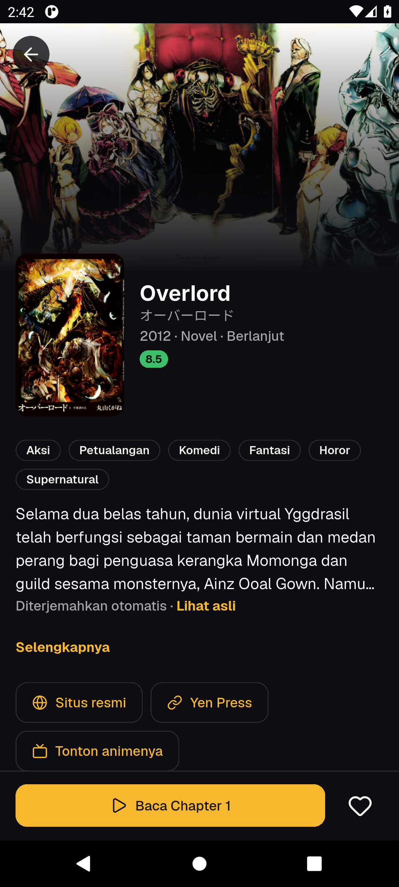<br><sub>Detail novel dan terjemahan otomatis</sub></td>
    <td align="center">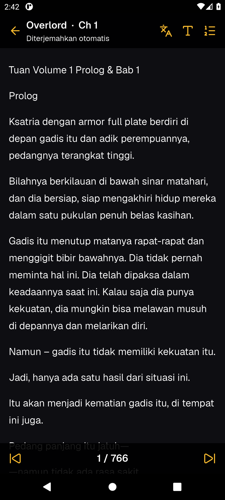<br><sub>Pembaca teks</sub></td>
  </tr>
  <tr>
    <td align="center">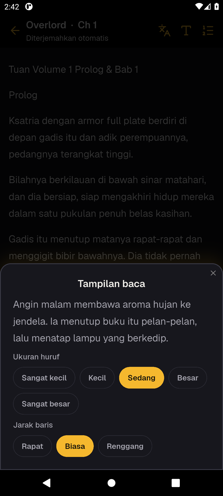<br><sub>Tampilan baca</sub></td>
    <td align="center">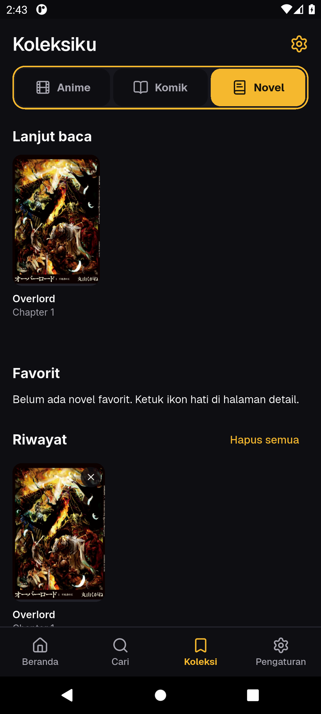<br><sub>Koleksi Anime, Komik, dan Novel</sub></td>
    <td></td>
  </tr>
</table>

## Struktur

| Folder | Isi |
|---|---|
| `app/` | Antarmuka Flutter (Riverpod, go_router, shadcn_ui) |
| `core/` | Workspace Rust: `domain`, `application`, `infrastructure`, `bridge`, `updater` |
| `scripts/` | Verifikasi, pemeriksa, dan skrip rilis |

Aturan arsitektur: `domain` tidak bergantung pada apa pun, `application` hanya pada `domain`, dan semua HTTP serta parsing situs ada di `infrastructure`. Folder `app/lib` tidak melakukan HTTP atau parsing situs.

## Menjalankan pemeriksaan

```powershell
pwsh scripts/verify.ps1
```

Skrip ini menjalankan `cargo fmt`, `cargo clippy -D warnings`, `cargo test`, `dart format`, `flutter analyze`, `flutter test`, dan pemeriksa rahasia. Pemeriksa tambahan:

```powershell
pwsh scripts/check-lib.ps1          # tidak ada jaringan atau kata Inggris di app/lib
pwsh scripts/check-apk.ps1 -Apk <berkas.apk>   # tidak ada rahasia di APK, daftar host
```

## Membangun

```powershell
cd app
flutter build apk --release --target-platform android-arm,android-arm64
```

Build rilis ditandatangani dengan keystore lokal yang diatur lewat `app/android/key.properties` (tidak masuk repo).

## Rilis

```powershell
pwsh scripts/release.ps1 -Version 0.3.0              # uji: bangun dan siapkan dist/, tanpa menerbitkan
pwsh scripts/release.ps1 -Version 0.3.0 -Publish     # tag, push, dan buat rilis GitHub
```

Versi pada `app/pubspec.yaml` harus sama dengan `-Version`. Skrip berhenti di kegagalan pertama dan menghasilkan satu berkas `kolektaku-mobile-<versi>.apk` (ARM 64-bit dan 32-bit, tanpa varian emulator) beserta `latest.json` yang dibaca aplikasi untuk memeriksa pembaruan.

## Menambah sumber baru

Cukup satu folder di `core/crates/infrastructure/src/sources/`, fixture-nya, dan satu baris di `registry.rs`; `scripts/new-source.ps1` membuat kerangkanya.
