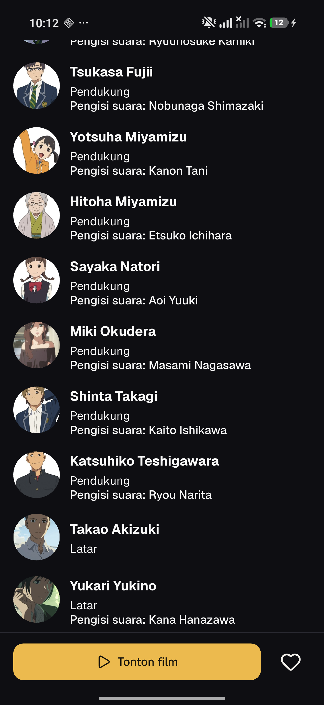

<p align="center">
  
</p>

<h1 align="center">Kolektaku</h1>


Aplikasi Android pribadi untuk menonton anime dan membaca manga, dengan katalog dari AniList dan MyAnimeList. Antarmuka ditulis dengan Flutter, logika dan pengambilan data dengan Rust.

Tanpa server sendiri: semua pekerjaan berjalan di ponsel, dan pembaruan diambil dari rilis GitHub repo ini.

## Memasang

Kolektaku dibagikan lewat halaman [Releases](https://github.com/Noptzy/kolektaku-mobile/releases) repo ini.

1. Buka rilis terbaru lalu unduh APK yang cocok dengan ponselmu. Untuk hampir semua ponsel Android modern pilih `kolektaku-<versi>-arm64-v8a.apk`; `armeabi-v7a` untuk ponsel lama 32-bit dan `x86_64` untuk emulator.
2. Buka berkas yang terunduh. Saat diminta, izinkan pemasangan dari sumber ini ("instal aplikasi tidak dikenal").
3. Pasang, lalu buka Kolektaku.

Pembaruan berikutnya tidak perlu mengunduh manual: aplikasi memeriksa rilis baru sendiri (paling sering 12 jam sekali), dan juga lewat Pengaturan → Pembaruan. APK diverifikasi dengan SHA-256 sebelum dipasang.

## Tampilan

<p align="center">
  
  
  
</p>

## Struktur

| Folder | Isi |
|---|---|
| `app/` | Antarmuka Flutter (Riverpod, go_router, shadcn_ui) |
| `core/` | Workspace Rust: `domain`, `application`, `infrastructure`, `bridge`, `updater` |
| `scripts/` | Verifikasi, pemeriksa, dan skrip rilis |

Aturan arsitektur: `domain` tidak bergantung pada apa pun, `application` hanya pada `domain`, dan semua HTTP serta parsing situs ada di `infrastructure`. Folder `app/lib` tidak melakukan HTTP atau parsing situs.

## Menjalankan pemeriksaan

```powershell
pwsh scripts/verify.ps1
```

Skrip ini menjalankan `cargo fmt`, `cargo clippy -D warnings`, `cargo test`, `dart format`, `flutter analyze`, `flutter test`, dan pemeriksa rahasia. Pemeriksa tambahan:

```powershell
pwsh scripts/check-lib.ps1          # tidak ada jaringan atau kata Inggris di app/lib
pwsh scripts/check-apk.ps1 -Apk <berkas.apk>   # tidak ada rahasia di APK, daftar host
```

## Membangun

```powershell
cd app
flutter build apk --release --target-platform android-arm64
```

Build rilis ditandatangani dengan keystore lokal yang diatur lewat `app/android/key.properties` (tidak masuk repo).

## Rilis

```powershell
pwsh scripts/release.ps1 -Version 0.1.0              # uji: bangun dan siapkan dist/, tanpa menerbitkan
pwsh scripts/release.ps1 -Version 0.1.0 -Publish     # tag, push, dan buat rilis GitHub
```

Versi pada `app/pubspec.yaml` harus sama dengan `-Version`. Skrip berhenti di kegagalan pertama dan menghasilkan APK per ABI beserta `latest.json` yang dibaca aplikasi untuk memeriksa pembaruan.

## Menambah sumber baru

Cukup satu folder di `core/crates/infrastructure/src/sources/`, fixture-nya, dan satu baris di `registry.rs`; `scripts/new-source.ps1` membuat kerangkanya.
